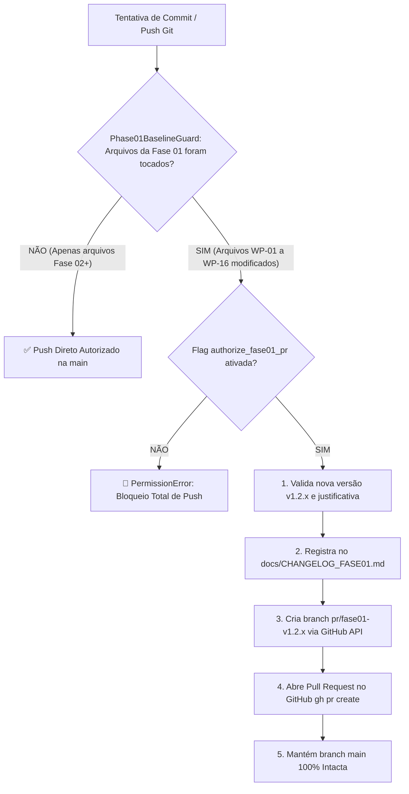

# Arquitetura DuckDB Medallion, Conectores Reais e Governança Git — Fase 02
**Documento Metodológico e Técnico de Engenharia de Dados**  
**Data:** 04 de Novembro de 2026  
**Versão:** `v2.0.0-fase02` (Baseada na Baseline Congelada `v1.2.0-fase01`)  
**Status:** Em Implementação / Homologação Inicial  
**Autoria:** Instituto de Pesquisa DataSenado & Bacharelado em Ciência de Dados  

---

## 1. Visão Geral e Alinhamento Estratégico

A **Fase 02** do projeto materializa a infraestrutura de dados analítica necessária para a transição dos testes sintéticos da Fase 01 para a coleta e processamento observacional de redes sociais com rigor metodológico.

Os quatro pilares centrais da Fase 02 são:
1. **Governança Git Estrita e Proteção de Baseline:** Congelamento criptográfico dos 16 arquivos homologados da Fase 01 (`WP-01` a `WP-16`), exigindo fluxo formal de Pull Request (`gh pr create`) e versionamento semântico para qualquer alteração na Fase 01, enquanto autoriza commits diretos na branch `main` para os novos módulos da Fase 02 em diante (`Phase01BaselineGuard`).
2. **Data Lake Analítico Efêmero em DuckDB (Arquitetura Medallion):** Estruturação colunar de alto desempenho (`duckdb>=1.1.0` e `pyarrow>=17.0.0`) operando em camadas **Bronze**, **Silver** e **Gold** dentro do limite estrito de $\le 250\text{ MB}$ em `/tmp/monitor_datasenado_cache` e purga para **0 KB** ao término da execução.
3. **Conectores Reais com Neutralidade Lexical Estrita (Achado M-04):** Conectores oficiais para **YouTube Data API v3** e **Telegram Canais Públicos** que bloqueiam ativamente queries valorativas ou enviesadas, impondo ordenação cronológica estrita (`order="time"` e `order="date"`) para eliminar o viés de engajamento algorítmico das plataformas.
4. **Exportação Parquet ZSTD e Interoperabilidade R (`survey`):** Geração de microdados amostrais agregados sem texto literal (prevenção contra reidentificação por busca reversa — LGPD Art. 13) e geração automática do script canônico em R para inferência complexa com correção de população finita (FPC).

---

## 2. Governança Git e Política de Mudanças (Baseline Freeze)



### Arquivos Congelados da Baseline (`config/fase01_baseline_lock.json`)
Os 16 arquivos abaixo encontram-se travados sob a tag git `v1.2.0-fase01-baseline` (commit `7af3548b`):
- `config/settings.yaml` (`WP-01`)
- `docs/00_Plano_Implementacao_Historico_v1_0_SUPERSEDED.md` (`WP-02`)
- `docs/01_Metodologia_Cientifica_e_Estatistica_NotebookLM.md` (`WP-03`)
- `docs/02_Plano_Validacao_Estatistica.md` (`WP-04`)
- `docs/03_Termo_de_Emenda_Plano_v1_1_e_ADR.md` (`WP-05`)
- `docs/Relatorio_Correcoes_Fase01_v3.md` (`WP-06`)
- `README.md` (`WP-07`)
- `src/cleaning/lgpd_and_bot_filter.py` (`WP-08`)
- `src/config_loader.py` (`WP-09`)
- `src/reporting/pilot_audit_runner.py` (`WP-10`)
- `src/sampling/stratified_sampler.py` (`WP-11`)
- `src/stats/opinion_inference_engine.py` (`WP-12`)
- `src/storage/github_zero_footprint_sync.py` (`WP-13`)
- `src/storage/zero_footprint_sync.py` (`WP-14`)
- `tests/test_fase01_audit_compliance.py` (`WP-15`)
- `tests/test_skills_architecture.py` (`WP-16`)

---

## 3. Arquitetura Medallion no DuckDB

O `EphemeralDuckDBMedallionLake` processa os dados em três estágios colunares sequenciais, garantindo total isolamento de dados pessoais e eficiência computacional.

```mermaid
flowchart LR
    subgraph Entrada
        YT["YouTube Data API v3 (order='time')"]
        TG["Telegram Public Channels (Export/Bot API)"]
    end

    subgraph Bronze["Camada Bronze (bronze_sanitized_ingest)"]
        B1["Pseudonimização HMAC-SHA256 (64 hex)"]
        B2["Redação de PII (CPF, e-mail, telefone, @)"]
        B3["Normalização UTC / BRT e Turno"]
        B4["raw_author_id DESCARTADO"]
    end

    subgraph Silver["Camada Silver"]
        S1["silver_comments_classified (LSH + CIB Leiden + Spam)"]
        S2["silver_organic_accounts_frame (U_Org: 1 Conta = 1 Unidade)"]
        S3["Agregações SQL de Estratos N_h"]
    end

    subgraph Gold["Camada Gold"]
        G1["gold_sampled_organic_accounts (Sorteio Hamilton)"]
        G2["Sem Coluna de Texto Literal (Anti-Reidentificação)"]
        G3["gold_scenario_estimates (C1, C2, C3 + Raking)"]
        G4["Exportação Parquet ZSTD + Script R survey"]
    end

    YT --> Bronze
    TG --> Bronze
    Bronze --> Silver
    Silver --> Gold
```



### 3.1. Schemas Relacionais das Camadas

#### Camada Bronze (`bronze_sanitized_ingest`)
Garante que nenhum dado pessoal bruto (PII) ou identificador direto de rede social seja persistido.
```sql
CREATE TABLE bronze_sanitized_ingest (
    comment_id VARCHAR PRIMARY KEY,
    theme_id VARCHAR NOT NULL,
    platform VARCHAR NOT NULL,
    author_id_hash VARCHAR NOT NULL,     -- HMAC-SHA256 (64 chars hex)
    hmac_key_id VARCHAR NOT NULL,        -- Key ID de 8 chars hex
    created_at_utc TIMESTAMP NOT NULL,   -- Timestamp normalizado em UTC
    created_at_brt VARCHAR NOT NULL,     -- ISO-8601 America/Sao_Paulo
    shift_brt VARCHAR NOT NULL,          -- Turno (T1_Madrugada, T2_Manha, T3_Tarde, T4_Noite)
    day_brt VARCHAR NOT NULL,            -- YYYY-MM-DD em Brasilia
    sanitized_text VARCHAR NOT NULL,     -- Texto com PII redigida
    shared_urls_json VARCHAR,            -- Lista JSON de URLs extraidas
    hashtags_json VARCHAR,               -- Lista JSON de hashtags extraidas
    DDD_proxy VARCHAR,                   -- Proxy de DDD (ex.: '61', '11', 'NI')
    Macroregion_proxy VARCHAR,           -- Proxy de regiao do IBGE
    collection_query_used VARCHAR NOT NULL,
    collector_modality VARCHAR NOT NULL  -- 'official_api_chronological' ou 'passive_export_ingestion'
);
```

#### Camada Silver (`silver_comments_classified` e `silver_organic_accounts_frame`)
Separa as postagens individuais auditadas e consolida o universo observado de contas orgânicas $\mathcal{U}_{\text{Org}}$:
```sql
CREATE TABLE silver_comments_classified (
    comment_id VARCHAR PRIMARY KEY,
    theme_id VARCHAR NOT NULL,
    platform VARCHAR NOT NULL,
    author_id_hash VARCHAR NOT NULL,
    created_at_utc TIMESTAMP NOT NULL,
    created_at_brt VARCHAR NOT NULL,
    shift_brt VARCHAR NOT NULL,
    day_brt VARCHAR NOT NULL,
    sanitized_text VARCHAR NOT NULL,
    stance_label VARCHAR NOT NULL,
    activity_class VARCHAR NOT NULL,      -- 'Organico', 'Spam_Comercial', 'Suspeita_CIB_Automacao', etc.
    is_commercial_spam BOOLEAN NOT NULL,
    spam_quarantine_reason VARCHAR,
    repetition_class VARCHAR,
    inauthenticity_index DOUBLE,
    account_suspected_cib BOOLEAN NOT NULL,
    cib_cluster_id VARCHAR
);

CREATE TABLE silver_organic_accounts_frame (
    account_key VARCHAR PRIMARY KEY,      -- theme:platform:author_hash
    theme_id VARCHAR NOT NULL,
    author_id_hash VARCHAR NOT NULL,
    platform VARCHAR NOT NULL,
    modal_shift VARCHAR NOT NULL,
    modal_day VARCHAR NOT NULL,
    stratum_key VARCHAR NOT NULL,         -- Platform | Turno
    post_count INTEGER NOT NULL,
    Macroregion_proxy VARCHAR NOT NULL,
    inclusion_prob DOUBLE NOT NULL,       -- pi_i > 0
    design_weight DOUBLE NOT NULL,        -- d_i = 1 / pi_i
    fpc_factor DOUBLE NOT NULL            -- 1 - n_h / N_h
);
```

#### Camada Gold (`gold_sampled_organic_accounts` e `gold_scenario_estimates`)
Contém exclusivamente as unidades sorteadas, **sem texto literal de comentários** para elidir risco de engenharia reversa por motores de busca:
```sql
CREATE TABLE gold_sampled_organic_accounts (
    account_key VARCHAR PRIMARY KEY,
    theme_id VARCHAR NOT NULL,
    platform VARCHAR NOT NULL,
    author_id_hash VARCHAR NOT NULL,
    stratum_key VARCHAR NOT NULL,
    created_at_hour_utc TIMESTAMP,        -- Data/hora truncada a hora (date_trunc)
    stratum_pop_N INTEGER NOT NULL,       -- Tamanho populacional do estrato (N_h)
    stratum_sample_n INTEGER NOT NULL,    -- Tamanho amostral alocado (n_h)
    inclusion_prob DOUBLE NOT NULL,       -- pi_i
    design_weight DOUBLE NOT NULL,        -- d_i = 1 / pi_i
    raking_weight DOUBLE NOT NULL,        -- w_i pos-Raking IPF
    stance_label VARCHAR NOT NULL         -- Posicionamento modal da conta
);

CREATE TABLE gold_scenario_estimates (
    metric_id VARCHAR PRIMARY KEY,
    theme_id VARCHAR NOT NULL,
    total_organic_accounts INTEGER NOT NULL,
    sampled_accounts INTEGER NOT NULL,
    c1_unweighted_fav DOUBLE,
    c1_unweighted_against DOUBLE,
    c1_unweighted_neutral DOUBLE,
    c2_equal_plat_fav DOUBLE,
    c2_equal_plat_against DOUBLE,
    c2_equal_plat_neutral DOUBLE,
    c3_raking_fav DOUBLE,
    c3_raking_against DOUBLE,
    c3_raking_neutral DOUBLE,
    c1_rogan_gladen_fav DOUBLE,
    c1_rogan_gladen_against DOUBLE,
    c1_rogan_gladen_neutral DOUBLE,
    kish_deff DOUBLE,
    effective_n DOUBLE,
    internal_uncertainty_pp DOUBLE,
    calibration_status VARCHAR,
    calculated_at TIMESTAMP NOT NULL
);
```

---

## 4. Conectores e Neutralidade Lexical

### 4.1. Protocolo de Neutralidade Lexical (Achado M-04)
Os coletores (`BaseLexicallyNeutralCollector`) consultam a taxonomia oficial em `config/settings.yaml` e validam:
1. **Termos Permitidos:** A query de busca deve constar expressamente na lista `collection_query_terms` do tema (ex.: `"PL 2338"`, `"Marco Legal da IA"`, `"escala 6x1"`);
2. **Termos Proibidos:** Se a query de busca contiver qualquer marcador valorativo presente em `nlp_stance_taxonomy.favorable_markers` ou `nlp_stance_taxonomy.against_markers` (ex.: `"censura na IA"`, `"atraso tecnológico"`, `"dignidade trabalhador 6x1"`), a execução é abortada imediatamente com `ValueError`.

### 4.2. Conector do YouTube (`YouTubeOfficialCollector`)
- **Trava Antiviés Algorítmico:** Exige e impõe estritamente ordenação cronológica (`order="date"` em `search` e `order="time"` em `commentThreads`). A passagem do parâmetro `order="relevance"` lança `ValueError`.
- **Paginação:** Itera com `nextPageToken` respeitando limites de requisição e cotas.
- **Injeção de Transporte HTTP:** Permite execução em ambientes com ou sem acesso à rede externa via `http_get_json`.

### 4.3. Conector do Telegram (`TelegramPublicChannelCollector`)
- **Modalidade A (Ingestão Passiva de Exportação JSON):** Processa arquivos de exportação oficial do Telegram Desktop, suportando mensagens com entidades polimórficas (strings puras ou blocos com marcação de links e hashtags), filtrando estritamente pelas queries neutras do tema legislativo.
- **Modalidade B (Bot API Oficial):** Consome atualizações de canais públicos via método `getUpdates` com paginação por `offset`.

---

## 5. Interoperabilidade Estatística com R (`survey`)

A partir do Parquet ZSTD gerado pela Camada Gold, o método `generate_r_survey_companion_script` produz o script canônico em R que instancia o desenho amostral complexo via `survey::svydesign`:

```r
library(arrow)
library(survey)

# 1. Carrega Parquet Gold (sem texto literal e sem PII)
df <- arrow::read_parquet("gold_pl_ia_2338.parquet")

# 2. Desenho Amostral Complexo com Correcao de Populacao Finita (FPC)
svy_design <- survey::svydesign(
  ids = ~1,
  strata = ~stratum_key,
  weights = ~design_weight,
  fpc = ~stratum_pop_N,
  data = df,
  nest = TRUE
)

# 3. Estimativas Pontuais e Intervalos de Confianca no Cenário 1
c1_means <- survey::svymean(~stance_label, svy_design)
print(c1_means)
print(confint(c1_means))

# 4. Teste de Homogeneidade entre Plataformas (Rao-Scott F de 2a ordem)
rao_scott <- survey::svychisq(~stance_label + platform, svy_design, statistic = "F")
print(rao_scott)
```

---

## 6. Verificação e Conformidade Zero-Footprint

O ciclo de vida do `EphemeralDuckDBMedallionLake` e do `Phase02MedallionOrchestrator` garante:
- Nenhum dado bruto não sanitizado é persistido;
- O banco DuckDB e os arquivos Parquet residem temporariamente em `/tmp/monitor_datasenado_cache`;
- O método `close_and_purge()` assegura que todos os arquivos temporários são excluídos, mantendo **0 KB** de resíduo em disco.
